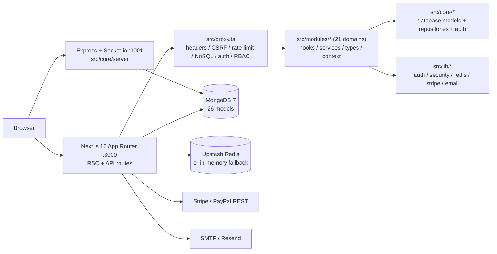
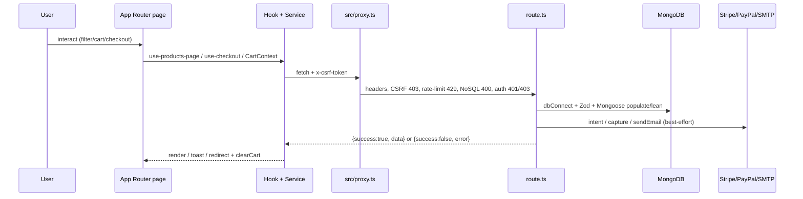
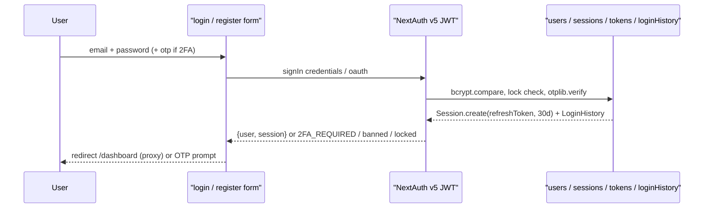
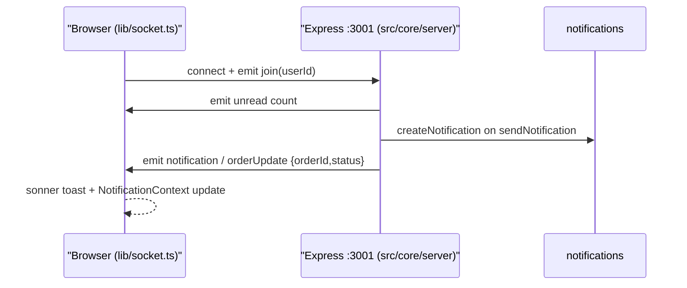

# Nexus E-Commerce Platform

Nexus (`nexus-ecommerce@1.0.0`) is a full-stack e-commerce platform built with **Next.js 16 App Router, React 19, TypeScript strict, MongoDB 7 + Mongoose 9**. It ships a public storefront, customer dashboard, vendor portal, and admin panel backed by **81 API routes**, **26 Mongoose models**, and **21 domain modules** in `src/modules/`.

> This README describes only what is implemented in this checkout. No demo URL, screenshots, or AI service are present in the repo (see notes below).

---

## Overview

- **Storefront** (`src/app/(shop)/`): products, categories, bundles, search, compare, gift-cards, cart, checkout/success, order-confirmation, track-order, wishlist, saved.
- **Auth** (`src/app/(auth)/`): login, register, verify-email, forgot-password, reset-password/[token], accept-invite.
- **Customer dashboard** (`src/app/(dashboard)/`): dashboard, orders, profile, security, support/tickets, addresses, wishlist, returns, payments, notifications, tracking.
- **Admin** (`src/app/admin/`): 27 pages — dashboard, products, categories, brands, orders, customers, vendors, inventory, low-stock, coupons, gift-cards, marketing/banners, sales, revenue, analytics, reports, reviews, roles, permissions, notifications, audit-logs, settings, abandoned-carts, contact, faqs.
- **Vendor** (`src/app/vendor/`): register, dashboard.
- **System**: `about, contact, faq, pricing, partners, careers, changelog, docs/api, banned, maintenance, offline`, plus `loading.tsx, error.tsx, global-error.tsx, not-found.tsx, robots.ts, sitemap.ts`.
- **Health**: `GET /api/health` → `{ status: "ok", timestamp, uptime }` (`src/app/api/health/route.ts`).

---

## Features

- Catalog with filters/sort/pagination, product detail with variants, reviews, related items, frequently-bought-together, price history.
- Full-text + suggestion + popular search (`src/app/api/search/*`, `src/app/api/products/search/route.ts`).
- Client cart (`CartContext` + `localStorage "cart"`), stock guard, save-for-later, abandoned-cart persistence (`src/app/api/abandoned-carts/*`).
- Server-backed wishlist, client compare tray, recently-viewed.
- Guest + authenticated checkout with shipping/tax/coupon and Stripe PaymentIntents, PayPal Orders v2, COD / bKash / Nagad / Rocket.
- Orders with tracking timeline, invoices (`src/lib/invoice.ts` + `jspdf`), returns/RMA.
- Promotions: coupons, gift cards (purchase/redeem), bundles, marketing banners.
- Support tickets, FAQs, contact messages, in-app notifications, price/stock alerts.
- Vendor registration, approval (`pending → approved/rejected/suspended`), commission (10%), payouts.
- PWA: `public/manifest.json`, `public/sw.js` (`shoppro-v1`), install prompt, offline page.
- Theming (light/dark via `next-themes`), responsive layout with mobile `BottomNav`.

---

## Tech Stack

| Category | Exact package/version |
|---|---|
| Framework | `next@16.0.7` (App Router, `output: "standalone"`) |
| UI | `react@19.2.0`, `react-dom@19.2.0` |
| Language | `typescript@^5` (strict, `@/*` → `./src/*`) |
| DB | `mongoose@^9.0.1`, `mongodb@^6.21.0` |
| Auth | `next-auth@^5.0.0-beta.30`, `@auth/mongodb-adapter@^3.11.1`, `bcrypt@^6.0.0`, `bcryptjs@^3.0.3`, `jsonwebtoken@^9.0.3`, `otplib@^12.0.1`, `speakeasy@^2.0.0`, `qrcode@^1.5.4` |
| Payments | `stripe@^20.2.0`, `@stripe/stripe-js@^8.6.3`, `@stripe/react-stripe-js@^5.4.1`; PayPal via raw REST `fetch` (no SDK) |
| Realtime | `express@^4.21.2`, `socket.io@^4.8.1`, `socket.io-client@^4.8.1`, `helmet@^8.2.0` |
| Cache/rate-limit | `@upstash/redis@^1.36.0`, `@upstash/ratelimit@^2.0.7` (+ in-memory `src/lib/rate-limit.ts` fallback) |
| Forms/validation | `react-hook-form@^7.68.0`, `@hookform/resolvers@^5.2.2`, `zod@^4.2.1` |
| UI primitives | ~20 `@radix-ui/*`, `cmdk`, `vaul`, `embla-carousel-react`, `framer-motion@^12.28.1`, `lucide-react`, `sonner`, `next-themes@^0.4.6` |
| Data viz/PDF | `recharts@^2.15.4`, `jspdf@^4.0.0`, `jspdf-autotable@^5.0.7` |
| Email | `nodemailer@^7.0.11`, `resend@^6.6.0`, `@react-email/components`, `react-email` |
| Media | `sharp@^0.34.5`, `react-dropzone@^14.3.8`, `slugify` |
| Styling | `tailwindcss@^4`, `@tailwindcss/postcss@^4`, `tw-animate-css`, `components.json` (`new-york`, `neutral`) |
| Obs./analytics | `@sentry/nextjs@^10.64.0`, `@next/third-parties@^16.1.4`, `@next/bundle-analyzer@^16.2.10` |
| Tooling | `tsx`, `dotenv`, `eslint@^9`, `eslint-config-next@16.0.7` (plus `vitest`/`concurrently` referenced by scripts but **not** in `package.json` — see Troubleshooting) |

> Note: `@reduxjs/toolkit` + `react-redux` are installed but have **zero imports in `src/`**. State is React Context + `localStorage` (see State section).

---

## Architecture



Layering: `src/app/` (presentation) → `src/modules/` (domain: `hooks/services/types/context/validators`) → `src/core/` + `src/lib/` (infrastructure). Services call `src/shared/services/api-client.ts` or `src/lib/security/csrf-client.ts`; components never fetch directly.

### Project Structure

```
src/
  app/
    (auth)/ login register verify-email forgot-password reset-password/[token] accept-invite
    (shop)/ products/[id] products/[slug] categories bundles cart checkout/success
            search compare gift-cards orders track-order wishlist returns saved
    (dashboard)/ dashboard orders profile security support
    admin/ (27 pages) vendor/ (register dashboard)
    api/ (81 route.ts, 28 groups)
  modules/ admin analytics auth bundles cart categories checkout common compare
           gift-cards notifications orders products returns reviews search
           settings support user vendor wishlist
  core/
    config/database.ts
    database/models/ (26 files) repositories/ (user/product/order) seed/
    auth/index.ts  server/{config,controllers,middlewares,routes,services}
  components/ (33 groups: ui layout cart products home checkout search orders
               admin vendor dashboard auth support pwa common ...)
  lib/ auth config index + security/* (9) + redis rate-limit rbac routes
       validations stripe email sms socket checkout-utils notifications audit ...
  shared/ services/api-client.ts hooks utils types constants lib
  proxy.ts  hooks/ (useIsMobile, useReducedMotion)  config/
public/ manifest.json sw.js offline.html uploads/ (ephemeral local uploads) icons/
scripts/healthcheck.mjs  Dockerfile  docker-compose.yml  docker-compose.prod.yml
.github/workflows/ci.yml cd.yml docker-build.yml
ARCHITECTURE.md API.md DATABASE.md DEPLOYMENT.md ENVIRONMENT.md TESTING.md AGENTS.md
```

> Known gaps: `src/app/api/bundles/[id]/`, `vendors/[id]/`, `orders/[id]/tracking/`, `gift-cards/[code]/redeem/`, and `products/[id]/reviews/` exist as **empty placeholder directories with no `route.ts`** — the endpoints are not implemented (see API Architecture and Troubleshooting).

---

## How It Works

### Application Flow



- Client: `src/shared/services/api-client.ts` (`ApiClient`, `x-csrf-token` from `csrf-token` cookie) + global `fetch` patch in `src/app/providers.tsx:24-38`.
- Server: `dbConnect()` (`src/core/config/database.ts`, `maxPoolSize:10`) → `auth()` → `checkRole/checkPermission` (`src/lib/rbac.ts`) → `*.safeParse()` (`src/lib/validations.ts`) → Mongoose → `NextResponse.json({success, ...})`.
- Envelope: success `{ success:true, <resource>, pagination? }`, error `{ success:false, error }`.
- Cache: `GET /api/products` sets `Cache-Control: public, max-age=60, stale-while-revalidate=300`; queries use `.lean()`, `populate(category,brandRef)`, `countDocuments`.

Example client:

```ts
import { apiClient } from "@/shared/services/api-client";

type ProductList = { success: boolean; products: unknown[]; pagination: object };

const data = await apiClient.get<ProductList>("/api/products", {
  category: "electronics",
  page: "1",
  limit: "12",
});
```

---

## Authentication



- `src/lib/auth/config.ts` (edge-safe) + `src/lib/auth/index.ts` (Node): `session.strategy:"jwt"`, `maxAge:30d`, cookie `__Secure-next-auth.session-token` (prod) else `next-auth.session-token`.
- Providers: `Credentials{email,password,otp}`, `Google(GOOGLE_CLIENT_ID/SECRET)`, `GitHub(GITHUB_CLIENT_ID/SECRET)`.
- Credentials `authorize()`: lookup `+password+twoFactorSecret` → reject `banned/unverified/locked` → `bcrypt.compare` → on fail `loginAttempts++`, lock 15m after 5, `LOGIN_FAILED` + history → if `twoFactorEnabled` require `otp` (`otplib.authenticator.verify`) → reset attempts, `lastLogin/IP`, `randomBytes(40)` refresh token, `Session.create({expires:30d})`.
- OAuth `signIn`: require email, block `banned`/2FA accounts, link-or-create (`count==0 ? admin : user`, `isVerified:true`, `referralCode UM-*`).
- `jwt/session` callbacks re-validate `status/lock/Session.revoked/expires` on every request; `expired` sessions get `expires=epoch`.
- Register (`src/app/api/register/route.ts`): `3/60s` limit + `Settings.allowRegistration` + Zod → first user `admin` (auto-verified), others `user` + 6-digit OTP (10m) via `sendVerificationOTP`.
- 2FA: `POST /api/auth/2fa/setup` (secret + `keyuri` + QR `dataURL`, `enabled:false`) → `POST /api/auth/2fa/verify` (`enabled:true`).
- Sessions: `GET /api/auth/sessions`, `DELETE /api/auth/sessions/[id]`, `POST /api/auth/sessions/revoke-all`, `GET /api/auth/login-history`.
- Recovery/invite: `POST /api/forgot-password`, `POST /api/auth/reset-password` (sha256 token, `bcrypt(12)`, revoke all), `POST /api/auth/accept-invite` (`Token{type:invite}`), `GET /api/auth/verify-email?token=`.
- `src/proxy.ts`: `banned→/banned`, logged-in + `/login|/register →/dashboard`, `ADMIN_ROUTES + role!=admin →/dashboard` (pages) / `403` (API), anon + private page → `/login`, API anon → `401`.

---

## API Architecture

81 `route.ts` files in 28 groups under `src/app/api/`:

| Group | Routes |
|---|---|
| `products` | `GET/POST /api/products`, `GET/PATCH/DELETE /api/products/[id]`, `GET /api/products/[id]/related`, `.../price-history`, `.../frequently-bought-together`, `GET /api/products/search|filters|recommendations|low-stock` |
| `orders` | `GET/POST /api/orders`, `POST /api/orders/guest` — ⚠️ `src/modules/orders/services/order-service.ts:35-39` also calls `/api/orders/[id]` and `/api/orders/[id]/tracking`, but neither has a `route.ts` (empty placeholder dirs), so order detail/tracking via API is currently broken |
| `payments` | `POST /api/payments/create-intent`, `POST /api/payments/paypal/create-order`, `POST /api/payments/paypal/capture-order` |
| `admin` (23) | `admin/users|orders|reviews|analytics|activity|audit-logs|sales(+/categories\|/products)|revenue(+/payments\|/forecast)|reports|brands|settings|permissions|roles|invite|system-health|notifications(+/templates)|marketing/coupons|marketing/banners` |
| `auth` (11) | `auth/[...nextauth]`, `auth/verify-email|accept-invite|validate-token|resend-verification|reset-password`, `auth/2fa/setup|verify`, `auth/sessions(+/[id]\|/revoke-all)`, `auth/login-history` |
| `user` | `GET/PUT /api/user/profile`, `PUT /api/user/password`, `POST /api/user/redeem`, `GET/POST /api/user/wishlist` |
| `search` | `GET /api/search|suggestions|popular` |
| `notifications` | `GET/POST /api/notifications`, `POST /api/notifications/mark-all-read|clear-all` |
| Singletons | `POST /api/register|verify-otp|forgot-password|upload`, `GET/POST/PATCH/DELETE /api/contact`, `GET /api/health|settings|categories|brands|bundles|gift-cards|vendors|payouts|returns|tickets|faqs|abandoned-carts|price-alerts|stock-alerts`, `GET/PUT/DELETE /api/faqs/[id]`, `PATCH/DELETE /api/abandoned-carts/[id]`, `POST /api/coupons/validate` |

Validation: `src/lib/validations.ts` (`register/login/forgot/reset/settings/adminUpdateUser/adminDeleteUser/product/order`) + `src/modules/checkout/validators/index.ts` (`shippingAddressSchema`); `safeParse` → `400 {success:false, error: issues[0].message}`.

RBAC: `checkRole(["admin"])` for users/delete, `checkRole(["admin","vendor"])` for upload/product writes; self-demote/delete blocked; `logAction()` (`src/lib/audit.ts`).

Examples:

```bash
# List products
curl "http://localhost:3000/api/products?category=electronics&page=1&limit=12"

# Validate coupon (authed, CSRF required for POST)
curl -X POST http://localhost:3000/api/coupons/validate \
  -H "Content-Type: application/json" -H "x-csrf-token: YOUR_CSRF_TOKEN" \
  -d '{"code":"WELCOME10","cartTotal":120}'

# Health
curl http://localhost:3000/api/health
# {"status":"ok","timestamp":"...","uptime":123.4}
```

> No `/api/cart` or `/api/checkout` exists — cart is `CartContext` + `localStorage`, checkout orchestrates `coupons/validate + payments/* + orders/*`. `RATE_LIMITED_ROUTES` still lists stale `/api/cart|checkout|reviews|login` keys.

---

## Database

Connection: `src/core/config/database.ts` — cached `global.mongoose`, `maxPoolSize:10`, `serverSelectionTimeoutMS:30000`, pre-imports 24 models for `populate()`.

`src/core/database/models/` (26 files):

| Model | Collection focus |
|---|---|
| `User.ts` | `email unique`, `password`, `role[user\|admin\|vendor]`, `status[active\|banned]`, OTP/tokens, `twoFactor*`, `addresses[]`, `wishlist→Product`, `loyaltyPoints`, `referralCode sparse unique`, `membershipTier[bronze\|silver\|gold\|platinum]` |
| `Product.ts` | `slug unique`, `variants[]` (auto colors/sizes), `imageGallery[]`, `specifications[]`, `rating/reviews[]`, virtuals `onSale/stockStatus/discountPercentage`; 21 indexes incl. weighted text + 9 compounds |
| `Order.ts` | `user?` (guest nullable), `items→Product`, `shippingAddress`, `paymentStatus[pending\|paid\|failed\|refunded]`, `orderStatus[processing\|shipped\|delivered\|cancelled\|returned]`, intent/transaction IDs, carrier/tracking |
| `Category.ts` | `slug unique`, `parent→Category`, virtuals `productCount/children`, helpers `getCategoryTree/getSubcategories/getCategoryPath` |
| `Brand/Bundle/Banner/Coupon/GiftCard` | brand text idx; bundle `validFrom/Until`; banner `type[promotion\|hero]`; coupon `code,start/end`; gift `code,remainingBalance,expiresAt` |
| `Vendor/Payout` | `userId unique`, `storeSlug unique`, `status[pending\|approved\|rejected\|suspended]`, `commissionRate:10`, balances |
| `Return/AbandonedCart/Notification/SupportTicket/StockAlert/PriceHistory/PopularSearch/Settings/ContactMessage/Faq` | `userId/orderId/status` idx; `expiresAt`; `userId+createdAt`; price points; `normalizedQuery unique`; `allowRegistration/maintenanceMode`; faq `isPublished` |
| `Session/Token/LoginHistory/AuditLog` | `sessionToken unique`, `revoked/expires`, TTL `expires:0`, `ip/userAgent/device`, `entityType/action` + redaction |

Repositories (`src/core/database/repositories/`): thin statics `UserRepository/ProductRepository/OrderRepository` (`findWithFilters limit:20 + populate`, `updateStock $inc`, `findFeatured`, `getSalesStats` aggregate paid sum/count). Seed (`npm run seed` → `src/core/database/seed/seed.ts`): wipes `User/Category/Product/Banner`, creates admin/user (`password123`), 7 L1 + 7 L2 categories, 201 products, 3 banners; `seed-gift-cards.ts` adds 3 codes.

---

## Project Structure

See Architecture tree above. Key conventions (`AGENTS.md`): feature dir `src/modules/<domain>/{hooks,services,types,context,validators,index.ts}`, components in `src/components/<domain>/`, API in `src/app/api/<domain>/`, response `{success,data?,error?,pagination?}`, Zod + `auth()` per route, `@/` alias, `cn()` + dark mode.

---

## Installation

Prerequisites: Node.js 20+, MongoDB 7 (local/Docker/Atlas), npm 10+.

```bash
git clone YOUR_REPO_URL
cd my-app
npm install   # Dockerfile uses npm ci
cp .env.example .env.local
```

Minimum `.env.local` (placeholders only — never commit secrets):

```env
MONGODB_URI=mongodb://localhost:27017/full_stack_e_commerce_next_js
AUTH_SECRET=YOUR_GENERATED_SECRET
ACCESS_TOKEN_SECRET=YOUR_GENERATED_HEX
REFRESH_TOKEN_SECRET=YOUR_GENERATED_HEX
```

Generate: `openssl rand -base64 32` or `node -e "console.log(require('crypto').randomBytes(32).toString('hex'))"`.

## Environment Variables

Full reference: `.env.example` (14 groups) + `ENVIRONMENT.md`. Names only:

- App: `AUTH_SECRET`, `AUTH_URL`, `NEXT_PUBLIC_BASE_URL`, `NEXT_PUBLIC_APP_URL`, `NODE_ENV`, `NEXT_PUBLIC_SITE_NAME`, `NEXT_PUBLIC_SITE_URL`
- OAuth: `GOOGLE_CLIENT_ID`, `GOOGLE_CLIENT_SECRET`, `GITHUB_CLIENT_ID`, `GITHUB_CLIENT_SECRET`, `AUTH_GOOGLE_ID`, `AUTH_GOOGLE_SECRET`, `AUTH_GITHUB_ID`, `AUTH_GITHUB_SECRET`
- DB: `MONGODB_URI`
- JWT: `ACCESS_TOKEN_SECRET`, `REFRESH_TOKEN_SECRET`, `ACCESS_TOKEN_EXPIRY`, `REFRESH_TOKEN_EXPIRY`
- Redis: `UPSTASH_REDIS_REST_URL`, `UPSTASH_REDIS_REST_TOKEN`
- Media: `NEXT_PUBLIC_CLOUDINARY_CLOUD_NAME`, `CLOUDINARY_API_KEY`, `CLOUDINARY_API_SECRET` (present in env but upload writes `public/uploads/` — see Troubleshooting)
- Email: `SMTP_HOST`, `SMTP_PORT`, `SMTP_SECURE`, `SMTP_USER`, `SMTP_PASS`, `EMAIL_FROM_NAME`, `EMAIL_FROM_ADDRESS`, `RESEND_API_KEY`, legacy `EMAIL_SERVER`, `EMAIL_FROM`, `EMAIL_PASSWORD`
- Socket: `NEXT_PUBLIC_SOCKET_URL`, `SOCKET_PORT`
- Stripe: `NEXT_PUBLIC_STRIPE_PUBLISHABLE_KEY`, `STRIPE_SECRET_KEY`, `STRIPE_WEBHOOK_SECRET`
- PayPal: `NEXT_PUBLIC_PAYPAL_CLIENT_ID`, `PAYPAL_CLIENT_ID`, `PAYPAL_CLIENT_SECRET`
- SEO/analytics: `NEXT_PUBLIC_GA_ID`, `NEXT_PUBLIC_GOOGLE_SITE_VERIFICATION`
- Ops: `ANALYZE`, `SENTRY_DSN`, `LOG_LEVEL`

## Running Locally

```bash
npm run dev          # Next.js :3000
npm run dev:socket   # Socket.io :3001 (see Troubleshooting — script path is stale)
npm run dev:all      # both via concurrently
npm run seed         # dev data (destructive: deleteMany 4 collections)
```

Open `http://localhost:3000`. Settings fallback keeps checkout usable if `GET /api/settings` is unconfigured.

## Available Scripts

| Script | Command |
|---|---|
| `dev` | `next dev` |
| `dev:socket` | `tsx server/index.ts` |
| `dev:all` | `concurrently "npm run dev" "npm run dev:socket"` |
| `build` | `next build` |
| `start` | `next start` |
| `lint` | `eslint` |
| `typecheck` | `tsc --noEmit` |
| `test`, `test:watch`, `test:ci` | `vitest run`, `vitest`, `vitest run --reporter=verbose` |
| `seed` | `tsx src/core/database/seed/seed.ts` |
| `docker:build`, `docker:up`, `docker:prod` | `docker compose build`, `docker compose up`, `docker compose -f docker-compose.prod.yml up -d` |

---

## Core Features

- **Catalog** (`use-products-page.ts` + `product-service.ts`): query → Mongo filter + `sortMap` + `populate+lean` + `Cache-Control 60s`.
- **Detail** (`use-product-detail.ts` + 10 sibling hooks): variants/SKU, stock counter, reviews tab/form, related, FBT, price-history chart (`recharts`), Q&A, share, size guide; `PATCH` logs `PriceHistory`.
- **Search** (`use-search-bar/page.ts` + `search-service.ts` + `SearchContext`): `$text` or escaped regex, `PopularSearch` upsert, facets `{categories,brands,priceRange}`.
- **Cart** (`CartContext.tsx` + `StockContext` + `SaveForLaterContext` + `cart-service.ts`): `localStorage`, memo totals, `sonner` guards; server only for `abandoned-carts`.
- **Checkout** (`use-checkout.ts` + `checkout-service.ts`): `GET /api/settings` → `validateAddressIntl`/`validatePhoneBD` → `getShippingRatesIntl`/`calculateTaxIntl` → `POST /api/coupons/validate` → Stripe (`amount*100`, `automatic_payment_methods`, `metadata.userId` → `{clientSecret}`) or PayPal (`Basic(id:secret)` → `/v2/checkout/orders` → capture → `{transactionId}`) or COD/mobile (`paymentPhoneNumber`, `pending`) → `POST /api/orders|/guest` (`guest` validates stock, `$inc`, `sendOrderStatusEmail` best-effort; auth route is thin — see Future Improvements).
- **Orders/tracking/returns**: `order-service.ts` + `use-orders-page/track-order/return-*` + `OrderTrackingContext`; status labels per `src/modules/orders/types/index.ts` (`pending→confirmed→processing→shipped→out_for_delivery→delivered/cancelled/returned`) — note the stored Mongoose enum (`src/core/database/models/Order.ts:83`) is narrower: `processing|shipped|delivered|cancelled|returned`; invoices via `jspdf`. ⚠️ Detail/tracking API calls (`/api/orders/[id]`, `/api/orders/[id]/tracking`) have no `route.ts` yet.
- **Promos**: coupon rule check (`dates/usageLimit/minPurchase/applicable*`), gift-card purchase (`POST /api/gift-cards`, `remainingBalance`; note `[code]/redeem` has no `route.ts` — loyalty redeem lives at `POST /api/user/redeem`), bundle fixed-price (`isBundle` cart item; bundle detail API `[id]` has no `route.ts`), public banners.

## Admin Features

Lists use `use-admin-*.ts` + `admin-service.ts` + `shadcn` tables + dialogs (`use-product-dialog`, `use-edit-user-dialog`, `use-coupon-dialog`); all `checkRole("admin")` (products allow vendor; delete admin-only) + `logAction()`.

- Commerce: products, categories, brands, inventory, low-stock (`stock <= 10`), orders, customers/[id], vendors, reviews, returns, abandoned-carts.
- Growth: dashboard, analytics (`use-analytics.ts`), sales (`sales-service.ts` + `/categories|/products`), revenue (`revenue-service.ts` + `/payments|/forecast`), reports (`report-service.ts` + `export-utils.ts` CSV/PDF), marketing coupons/banners (`marketing-service.ts`), notifications/templates, settings (`SettingsContext`, `maintenanceMode` gates `layout.tsx`).
- Governance: roles/permissions (`role-service.ts`; `admin=all, vendor=11, user=4` of 20 `manage:*|view:*` perms), audit-logs/activity (redacted), invite (`Token{type:invite}` + `sendInvitationEmail` → `accept-invite`), system-health (`use-system-health.ts`: db/redis/uptime).

---

## AI Integration

**None.** No `openai|anthropic|gemini|@ai-sdk|cohere` imports in `src/`, no AI deps in `package.json`, no `src/app/api/ai*`, no `ai/` directory. Recommendations are MongoDB queries/aggregates. No diagram — nothing to draw.

---

## Real-Time Communication



- Client: `src/lib/socket.ts` (`io(NEXT_PUBLIC_SOCKET_URL||:3001, autoConnect:false, reconnection 5×/1s)`, `getSocket/connectSocket/disconnectSocket`) re-exported by `src/shared/lib/socket.ts`; second client `src/modules/notifications/hooks/use-notification-socket.ts` (`autoConnect:true`, `join/leave`, `on notification/orderUpdate`).
- Server: `src/core/server/index.ts` (`express+http+SocketIO(cors: NEXT_PUBLIC_BASE_URL)`, `helmet`, `json({limit:1mb})`, `io.use(authenticateSocket)`, `setupRoutes(io)`, `GET /health`); port `SOCKET_PORT||3001` (`src/core/server/config/index.ts`); `notification-controller.ts` handles `join/leave/sendNotification/disconnect`.
- Events: `join, leave, joinRoom, leaveRoom, sendNotification` → `notification{id,title,message,type,link,createdAt}, orderUpdate{orderId,status,message}, message{from,content,timestamp}`.

---

## Security

- Headers/CSP (`src/lib/security/headers.ts` + `next.config.ts:headers()`): `default 'self'`, `script 'self' unsafe-inline + stripe/google`, `img data:blob: + unsplash/google/github/picsum/freepik/cloudinary`, `connect self+stripe+upstash`, `frame stripe`, `frame-ancestors none`, HSTS, `DENY`, `nosniff`, `Permissions-Policy`, COEP/COOP/CORP.
- CSRF double-submit (`csrf.ts` + `csrf-client.ts` + `providers.tsx` patch): `csrf-token` cookie on page `GET`, `x-csrf-token` on mutating `fetch`; `proxy.ts:62-73` → `403 Invalid CSRF token`.
- Rate-limit: `src/lib/redis.ts` (`INCR+EXPIRE`, sliding `ZSET`) + `src/lib/rate-limit.ts` (`Map`); 16 `RATE_LIMITED_ROUTES` (`src/lib/routes.ts`: `register 3/60s`, `verify-otp 5/60s`, `orders 30/60s`, `upload 10/60s`, …); fail-open if `UPSTASH_*` unset.
- NoSQL: `proxy.ts:10-20` regex (`$where|$ne|$gt|…|$or|$and|$not`) on **query params only** → `400`.
- XSS: `sanitize.ts` (`stripHtml/sanitizeObject/escapeRegex`); upload: `upload.ts` (`jpeg/png/webp/gif/svg`, `5MB`, `4096px`).
- Audit/logging/env/RBAC: `audit.ts` (redacts password/token/secret), `logger.ts` (`securityLog` JSON), `env.ts` (Zod), `rbac.ts` + `permissions.ts` (20 perms; legacy `shared/constants/permissions.ts` is unused — do not mix).
- Auth hardening: `bcrypt(12)`, 6-digit OTP/10m, 15m lock after 5 fails, sha256 reset, TTL indexes, `httpOnly/lax/secure` cookies, `banned` gate.

## Error Handling

- API: `NextResponse.json({success:false,error}, {status:400|401|403|404|409|429|500|503})`; client `ApiClient` throws `Error(error.error || HTTP <status>)`.
- Pages: `src/app/error.tsx` (reset), `global-error.tsx` (`Sentry.captureException`), `not-found.tsx`, `loading.tsx`, `offline/page.tsx`.
- Domain: Zod `400`, stock-insufficient `400`, slug/email `409`, email send swallowed (`try/catch`), socket falls back to polling.

## Performance

- Implemented: static/ISR pages, `next/dynamic ssr:false + skeletons`, `React.memo`, `useMemo` totals, `Cache-Control` on products, `lean/populate`, 21 product indexes, pagination, `removeConsole` prod, `ANALYZE=true` bundle report, `maxPoolSize:10`, standalone Docker.
- Watch: `countDocuments + find + populate` per listing (no Redis response cache), filter `distinct/aggregate` per search, `PopularSearch` write per query, 15-deep providers (`src/app/providers.tsx:44-74`), raw `public/uploads` (no `sharp` pipeline), heavy `recharts/jspdf/stripe` need route-level dynamic import audit.

---

## Deployment

Docker (`Dockerfile`: `deps (npm ci)` → `builder (npm run build)` → `runner (standalone, nextjs:nodejs, EXPOSE 3000, HEALTHCHECK scripts/healthcheck.mjs)`).

```bash
npm run build && npm run typecheck
docker compose up --build            # dev: app :3000 + mongo:7 :27017 + redis:7 :6379 (nexus-network)
docker compose -f docker-compose.prod.yml up -d   # prod: app only, host env
curl http://localhost:3000/api/health  # must be 200
```

CI: `.github/workflows/ci.yml` (lint + typecheck on Node 18/20/22, build on 20, `npm audit --production`), plus `cd.yml`, `docker-build.yml`. Prod checklist: Atlas whitelist, Upstash instance, `AUTH_SECRET`/JWT regen (override compose fallback), Sentry DSN, Stripe webhook config, `NEXT_PUBLIC_*` URLs.

---

## Troubleshooting

| Symptom | Cause (file) | Fix |
|---|---|---|
| `dev:socket` → `MODULE_NOT_FOUND server/index.ts` | `package.json:7` points to missing path; real `src/core/server/index.ts` | Run `npx tsx src/core/server/index.ts` until script is fixed |
| Rate-limit never fires | `UPSTASH_REDIS_REST_URL/TOKEN` empty; `redisRateLimit` fail-open (`src/lib/redis.ts`) | Set Upstash creds or wire local `redis:6379` via `ioredis` |
| `401 Unauthorized` on API | `proxy.ts:129` anon + non-public route | `signIn()` first; check `PUBLIC_ROUTES` in `src/lib/routes.ts` |
| `403 Invalid CSRF token` | Missing `x-csrf-token` on POST/PATCH/DELETE | Use `apiClient`/`csrfFetch`; ensure `csrf-token` cookie set on page `GET` |
| `400 Invalid request parameters` | NoSQL regex hit on query | Remove `$`-operators from query string; validate input |
| `503` from `create-intent` | `STRIPE_SECRET_KEY` placeholder → `stripe=null` (`src/lib/stripe.ts`) | Set real `sk_test_*` / `sk_live_*` |
| Upload `400` | `validateUpload` type/size/ext (`src/lib/security/upload.ts`) | Use jpeg/png/webp/gif/svg ≤5MB |
| Uploads vanish after redeploy | Files in `public/uploads/` (ephemeral, no volume; Cloudinary env unused) | Add volume short-term; migrate to Cloudinary/S3 |
| `GET /api/admin/* → 403` | `checkRole("admin")` | Assign `role:admin` via existing admin; never self-demote |
| `npm run dev:all → 'concurrently' not found` | `concurrently` used in `package.json:8` but not listed in dependencies | `npm i -D concurrently` (or run `dev` + `dev:socket` in separate terminals) |
| `npm run test* → 'vitest' not found` | `vitest` scripts exist but `vitest` is not in `package.json` and no test files ship in `src/` | Add `vitest` to devDependencies before running tests |
| `GET /api/orders/<id>(/tracking) → 404` | No `route.ts` (`orders/[id]/`, `tracking/` are empty placeholder dirs) | Implement `orders/[id]/route.ts` + `tracking/route.ts`, or retarget `order-service.ts` |
| `POST /api/gift-cards/<code>/redeem → 404` | No `route.ts` (`gift-cards/[code]/redeem/` is an empty placeholder dir) | Implement the redeem route, or use `POST /api/user/redeem` (loyalty) until then |

---

## Future Improvements

Suggested only (backed by findings, not scheduled):

1. Fix `dev:socket` path; unify to one socket singleton; add `@socket.io/redis-adapter` for multi-instance.
2. Align `RATE_LIMITED_ROUTES` with real 81 routes; validate JSON bodies for NoSQL; restrict public `admin/marketing/banners|settings` if sensitive.
3. Unify `POST /api/orders` with guest validation (Zod + `stock $gte qty` transaction), add idempotency key + `POST /api/webhooks/stripe` to reconcile `paid/failed/refunded` (no webhook route exists today).
4. Move uploads to Cloudinary/S3 + CDN (env vars already defined); add `sharp` resize/blur.
5. Remove dead `@reduxjs/toolkit`/`react-redux` or adopt; dedupe `lib` vs `shared/lib`; fix `models/index.ts` barrel (`Faq/ContactMessage`); delete legacy permissions file.
6. Add Redis response cache + TTL/caps for `LoginHistory/PopularSearch/AuditLog`; add `orders.guestEmail`, `notifications.userId+read` indexes.
7. Add Vitest coverage for `authorize`, register/OTP, guest stock decrement, coupon rules, upload, rate-limit.

---

## Further Reading

Repo docs (kept alongside this README): `ARCHITECTURE.md`, `API.md`, `DATABASE.md`, `DEPLOYMENT.md`, `ENVIRONMENT.md`, `TESTING.md`, `AGENTS.md`. Notes: `ENVIRONMENT.md` is the detailed env companion to `.env.example`; `AGENTS.md` references `NEXT_PUBLIC_SENTRY_DSN` while `.env.example` defines `SENTRY_DSN` — confirm which variable your Sentry setup reads before deploying. CI (`.github/workflows/ci.yml`) runs lint + typecheck on Node 18/20/22 and build on 20, so "Node.js 20+" in Installation satisfies the matrix. Product reviews UI (`use-review-form`, `use-reviews-tab`, `products/[id]/reviews/` placeholder dir) has no `route.ts` yet — review writes are not backed by an API route in this checkout.

## Contributing

1. Fork + `feature/<desc>` / `fix/<desc>` / `refactor/<desc>` / `chore/<desc>` / `docs/<desc>` from `main`.
2. Follow `AGENTS.md`: feature dirs `src/modules/<domain>/{hooks,services,types,context}`, `@/` alias, `cn()`, dark mode, `{success,data?,error?}` APIs, Zod + `auth()`.
3. `npm run typecheck && npm run lint && npm run test`.
4. Conventional Commits: `<type>(<scope>): <desc>` — types `feat|fix|docs|style|refactor|test|chore|perf|ci|build`; scopes `auth|cart|checkout|products|orders|admin|search|user|vendor|ui|api|db|security|docker|ci|docs`.

## License

> No `LICENSE` file is present in this checkout (`package.json` is `private:true` with no `license` field). All rights reserved by default. Add a `LICENSE` (e.g. MIT) before distributing.
